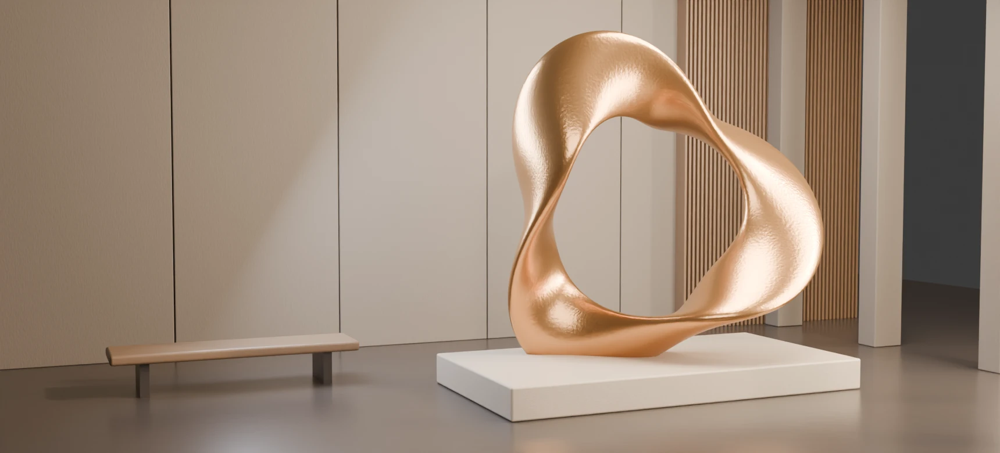

# Umbral

[English](README.md)

Galería virtual gratuita para artistas, músicos y programadores. Abrí una sala en el navegador o recorré la exposición en 3D con teclado, mouse o controles táctiles. [Entrar a Umbral](https://luzbel33.github.io/umbral-gallery/) · [Visitar el patio](https://luzbel33.github.io/umbral-gallery/?sala=patio).



## Visitar o exponer

Explorá el catálogo sin cuenta. Elegí una disciplina o entrá directamente desde el enlace de cualquier sala pública. Podés marcar favoritos como visitante en ese navegador. Al ingresar a una cuenta, las salas guardadas en ella se sincronizan entre dispositivos.

Probá la [sala de ejemplo editable](https://luzbel33.github.io/umbral-gallery/?sala=taller) sin registrarte. Sus cambios duran hasta recargar la pestaña. La [guía de visitantes y artistas](https://luzbel33.github.io/umbral-gallery/?guia=1) explica el recorrido completo.

En **Registrarme**, elegí usuario y contraseña y guardá el código de recuperación. En **Ingresar** también podés usar el acceso anterior de tu dispositivo. Con tu cuenta podés guardar favoritos y chatear sin crear una sala.

En **Mi espacio → Crear mi sala** elegí tamaño, color, piso, estilo de cartela y música. Completá tu biografía, web, hasta tres redes sociales y enlace de proyecto. En **Obras y archivos**, elegí una obra, editá título, técnica, año y texto, y tocá una de las ocho posiciones del plano. Podés elegir el ángulo inicial de una escultura. Recorré tu instalación antes de activar **Mostrar mi sala en el catálogo público**. Los archivos subidos se pueden abrir por enlace directo incluso en borrador. Podés liberar el cupo eliminando una sala vacía.

### Archivos que se pueden exponer

| Contenido | Formatos y experiencia |
| --- | --- |
| Imagen | JPG, PNG, WebP, AVIF, BMP y primer cuadro de GIF. Conversión a WebP de hasta 1.920 px por lado. |
| Video y música | Video MP4, WebM, MOV y OGV. Audio MP3, WAV, Ogg, Opus, M4A y FLAC. Reproductor del navegador según los códecs del dispositivo. Cada pista de audio puede elegirse como ambiente de sala. |
| Escultura, diseño y modelos | GLB, glTF con datos embebidos, OBJ, STL y PLY ASCII. Visor con giro y zoom. La geometría estática y el color base compatible se convierten al formato interno, con un límite de 60.000 triángulos. |
| Documentos y datos | PDF paginado en canvas, CSV y TSV en tabla, JSON formateado y cuadernos Jupyter con las celdas visibles. |
| Código y escritura | Texto UTF-8, Markdown, scripts, HTML, SVG como fuente, shaders y decenas de extensiones más. El contenido se muestra como texto. Las demos ejecutables y repositorios se abren desde el enlace externo que elija el artista. [Lista de extensiones](src/formats.js). |

El piloto admite 100 salas de artistas, incluidos borradores, y cuatro obras por sala. Al habilitar Cloudinary, cada sala dispone de 48 MiB propios para archivos de medios, incluidas las miniaturas (4.800 MiB en las 100 salas). PostgreSQL reserva el espacio antes de subir. El servidor autentica la subida, comprueba los bytes durante la transferencia y verifica el tamaño guardado por el proveedor. Los visitantes reproducen las obras desde la CDN de Cloudinary. Los archivos anteriores, los PDF y los archivos de imagen o datos que superen el máximo de 10 MB de Cloudinary Free siguen en Supabase. El editor muestra el espacio disponible para esos documentos. Ese depósito conserva 6 MiB por sala y una bolsa compartida de 200 MiB. Sus archivos también cuentan para los 48 MiB de la sala. Cada archivo listo admite hasta 32 MiB y los modelos originales hasta 12 MiB. Audio y video originales de hasta 128 MiB se preparan en el dispositivo. En navegadores compatibles el editor puede convertir a Opus o WebM de hasta 1280 px en el lado mayor y muestra el peso antes de subir. YouTube, Vimeo y SoundCloud se pueden exponer por enlace sin gastar espacio de archivos. El ambiente usa una pista subida. Al reproducir otra obra se pausa la anterior. El límite de código y texto es 512 KiB. Los modelos se validan y convierten antes de subirlos. Los visores especializados se cargan al abrir una obra y ponen límites al tamaño descargado. El PDF se dibuja sin habilitar scripts ni formularios interactivos. El sitio usa una política de contenido y los enlaces públicos abren sin acceso a la ventana de origen. Quien opera la galería puede ocultar una sala. Para reportar contenido, compartí la URL pública sin datos personales en los [issues del proyecto](https://github.com/Luzbel33/umbral-gallery/issues).

### Patio, chat y voz

La interfaz sigue el idioma principal del navegador. Podés cambiar entre español e inglés desde el menú. En escritorio, mové el mouse sin presionar para mirar. En el celular, caminá con el joystick y girá con el otro pulgar. La ficha del artista permite abrir sus obras y enlaces desde el recorrido.

Entrá al patio desde el menú en modo web o 3D. También podés activar **Caminar en compañía** en una exposición. Los visitantes que se suman comparten grupo, posiciones y chat. Con cuenta podés escribir y habilitar la voz. Al escuchar, el micrófono queda apagado hasta que mantenés presionado **Mantené para hablar**. Soltar el control, cambiar de ventana o llegar al límite de una intervención detiene la captura. El servidor reenvía el audio a oyentes del mismo grupo mediante canales privados. La aplicación no guarda grabaciones. Los últimos mensajes de los 15 minutos recientes se muestran en el grupo.

El cupo global es de 120 visitas sociales, de a seis por grupo. Al llenarse se conserva la visita individual. La capacidad observada, el coste de las descargas y los presupuestos de la voz están en el [informe de pruebas de carga](CAPACIDAD.md).

### Verificar el almacenamiento y la reproducción

En una cuenta temporal de Cloudinary, el titular ingresa su correo en el enlace privado y lo confirma desde el mensaje recibido. Hasta entonces, la entrega está restringida por IP. Conservá desactivada la ampliación del cupo hasta verificar las subidas y su reproducción desde otra red. [Confirmación de Cloudinary](https://cloudinary.com/documentation/claimable_cloud_provisioning)

Con el proyecto vinculado y las herramientas de Supabase y GitHub autenticadas, ejecutá `node scripts/test-cloud-media.mjs --deployed --independent`. La prueba sube un MP3 y un MP4, publica la sala temporal, entra como visitante sin cuenta, reproduce ambas obras, adelanta y confirma que siguen avanzando. También repite la reproducción desde otras redes en Chrome de escritorio, perfiles móviles de Pixel y iPhone en macOS y el navegador Chrome incluido en un emulador de Android 15. Al terminar retira las obras y libera el cupo. Para verificar el proveedor que usa un artista común, agregá `--active-storage`. El procedimiento de activación está en el [README principal](README.md).

## Desarrollo y publicación

Requiere Node 22.12 o posterior y un navegador moderno. El recorrido usa WebGL 2. La vista web permite visitar sin aceleración 3D.

```sh
npm ci
npm run dev
npm run build
```

Vite imprime la URL local. Por defecto el backend es el del piloto. Para desarrollar con datos propios, definí `VITE_SUPABASE_URL` y `VITE_SUPABASE_PUBLISHABLE_KEY`. `BASE_PATH` permite cambiar el prefijo `/umbral-gallery/`. GitHub Actions compila `dist/` y lo publica en Pages al actualizar `main`. Las exposiciones inaugurales disponen de páginas estáticas, metadatos de vista previa y sitemap.

Para una copia independiente, creá el proyecto de Supabase, actualizá los enlaces del sitio y del sitemap a tu dominio estable y configurá el origen HTTPS permitido para las funciones:

```sh
supabase link --project-ref TU_PROYECTO
supabase db push --linked
supabase secrets set GALLERY_ORIGIN=https://tu-dominio.example
supabase functions deploy gallery-account --use-api
supabase functions deploy gallery-passkeys --use-api
supabase functions deploy gallery-voice --use-api
supabase functions deploy gallery-public --use-api
supabase functions deploy gallery-media --use-api
```

La función de cuentas gestiona altas y recuperación. Supabase Auth verifica las contraseñas y emite sesiones. La función de llaves conserva el ingreso anterior con WebAuthn. Los retos firmados vencen en tres minutos y se consumen una sola vez. La función de voz comprueba la sesión, el turno y el cupo antes de transmitir. Las claves de servicio permanecen en el runtime del backend. PostgreSQL aplica propiedad por cuenta, permisos por fila, posiciones únicas, límites de texto y autorización por grupo. Storage sirve archivos públicos directamente. Las reservas de subidas interrumpidas pueden retirarse desde el editor.

Para las pruebas de navegación, iniciá el sitio en el puerto 5178 y ejecutá `npx playwright test`. `GALLERY_TEST_URL` y `CHROME_PATH` permiten elegir el sitio y el navegador. Para usar el navegador incluido en Playwright ejecutá previamente `npx playwright install chromium`. Para ensayar carga descargá y ejecutá una pila local de Supabase como se indica en el [informe reproducible](CAPACIDAD.md).

La prueba integral del editor y la comunidad usa dos cuentas temporales, contraseñas temporales y audio sintético. En la pila local, configurá un archivo de entorno con `GALLERY_ORIGIN=http://localhost:5184`, iniciá `supabase functions serve --env-file RUTA_AL_ARCHIVO` y ejecutá `node scripts/test-community.mjs`. Las capturas se guardan en `.qa/`. Para comprobar los cupos de artistas, la reserva de espacio y dos subidas reales simultáneas, ejecutá `node scripts/test-pilot.mjs` en Docker local.

En una copia alojada, restringí Realtime a canales privados desde la configuración del proyecto. La política de voz sólo permite escuchar el canal asignado a la propia visita autenticada. [Configuración de Realtime](https://supabase.com/docs/guides/realtime/settings).

## Arte y licencias

El código y las piezas originales de Estudio Umbral en este repositorio se distribuyen bajo [MIT](LICENSE). Cada persona conserva los derechos de las obras que suba. Instrument Serif y Space Grotesk usan SIL Open Font License 1.1. Sus licencias están en `public/licenses/`.

`art/interiors.py` construye las salas y hornea su iluminación en Blender. `art/media.py` crea el cortometraje con FFmpeg. *Cylinder Five* y *Cylinder Six*, de Chris Zabriskie, se reproducen bajo CC BY 4.0. La exposición de fotografía utiliza imágenes de dominio público del USGS. [Música](public/licenses/Cylinders.txt) · [Imágenes satelitales](public/licenses/Earth-As-Art.txt)
