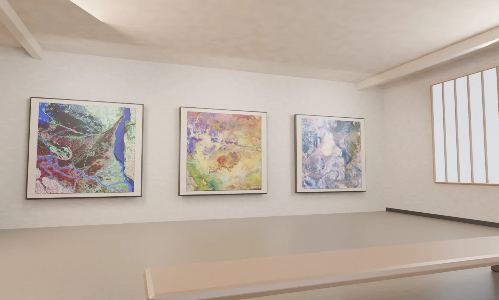

# Umbral

An open virtual museum for art, music and creative code. Visit an exhibition as a web page, walk through its architecture in 3D, or open a free room of your own. Umbral runs in the browser on desktop and mobile. [Visit the museum](https://luzbel33.github.io/umbral-gallery/) · [Enter the atrium](https://luzbel33.github.io/umbral-gallery/?sala=patio) · [Leer en español](README.es.md)



## Visit

Browse the catalogue by discipline or follow a direct room link as a guest. The website follows the browser's primary language, Spanish for Spanish variants and English otherwise. The language switch remembers your choice. Each room has a web exhibition, an artist profile and a walkable counterpart.

Move the mouse to look and use WASD to walk. **Enable free look** captures the pointer for unlimited turns. Escape releases it. On a touchscreen, walk with the analog stick and look with your other thumb. Use **Rooms** to change exhibitions from anywhere. Open **Artist & links** to find works and links. The cinema projects its film on request. The listening studio and atrium have separate recordings and playback controls.

## Exhibit

Try the [editable example](https://luzbel33.github.io/umbral-gallery/?sala=taller) as a guest. Changes to its works, floor plan and room settings stay in the tab until you refresh. The [visitor and artist guide](https://luzbel33.github.io/umbral-gallery/?guia=1) explains every step.

Choose **Sign up**, enter a username and password, and save the recovery code. Earlier device-based accounts can still sign in with their existing passkey. Each account can keep favorites and chat without opening a room.

Under **My space → Create my room**, set the dimensions, floor finish, wall color, label style and soundtrack. Add your bio, website, up to three social profiles and a project link. In **Works and files**, select a work, edit its title, medium, year and note, then choose one of eight mounting positions on the floor plan. Sculptures have a saved starting angle. Preview the installation before selecting the public catalogue option. Uploaded files can be accessed by direct URL even while the room is a draft. An empty room can be released back to the pilot.

| Media | Browser experience |
| --- | --- |
| Images | JPG, PNG, WebP, AVIF, BMP and the first frame of a GIF. Images become WebP up to 1,920 pixels on the long side, with lightweight previews for larger images. |
| Sound and moving image | MP3, WAV, Ogg, Opus, M4A, FLAC, MP4, WebM, MOV and OGV. Playback depends on the device's codecs. Audio works can become the room soundtrack. |
| 3D | Self-contained GLB/glTF, OBJ, STL and ASCII PLY. Static geometry and supported base colors are converted to a bounded internal mesh. Rotate and zoom in the viewer. Up to 60,000 triangles. |
| Documents and data | PDF pages rendered on canvas, CSV/TSV tables, formatted JSON and notebook cells. |
| Code and writing | UTF-8 text, Markdown, shaders and source code. HTML and SVG open as source. Authors can link to runnable demos on their own sites. [Supported extensions](src/formats.js) |

The pilot admits 100 artist rooms including drafts and four works per room. With Cloudinary delivery enabled, every room can store 48 MiB of media independently, including previews (4,800 MiB across 100 rooms). The editor reserves bytes in PostgreSQL before upload. Its authenticated media endpoint streams each file while checking its reserved size, then verifies the size reported by Cloudinary. Visitors stream media from the Cloudinary CDN. Existing objects, PDFs and non-video assets over Cloudinary Free’s 10 MB limit continue to use Supabase Storage, with the available document space shown in the editor. That bucket retains a 6 MiB reserve per room and a shared 200 MiB pool. Its bytes also count toward the 48 MiB room total. Finished uploads are limited to 32 MiB, source models to 12 MiB, and text/code to 512 KiB. Audio and video originals up to 128 MiB can be prepared in-browser. Supported browsers can encode Opus audio or a WebM video copy up to 1280 pixels on the long side. The editor displays the prepared size before upload. Public YouTube, Vimeo or SoundCloud links count as works without consuming file storage. Uploaded audio can be a soundtrack. Only one recording or video plays at a time. The PDF viewer disables scripting. Uploaded code is displayed as text. External links require HTTPS. To report content, include the room URL in a [repository issue](https://github.com/Luzbel33/umbral-gallery/issues).

## Shared visits

The atrium and exhibitions offer groups of six, with 120 social seats across the pilot. Individual visits remain available when all seats are occupied. Guests can read chat. Signed-in visitors can write and enable optional push-to-talk voice. Listening starts with the microphone off. Releasing the control stops capture. Voice packets use private recipient channels. Text chat displays recent messages for 15 minutes.

The [capacity report](CAPACITY.md) distinguishes browser rendering, simultaneous arrivals, social seats and monthly transfer. The public catalogue uses a bounded short-lived anonymous cache, keyset pagination and small cover images. Authenticated editing reads directly from the database. Inaugural rooms and their media are static files on GitHub Pages. The walk loads on entry, reuses baked lighting and adjusts its drawing resolution under frame pressure.

## Run locally

Use Node 22.12 or newer. Walk mode requires WebGL 2. The web version also works on devices without it.

```sh
npm ci
npm run dev
npm run build
```

Vite prints the local URL. The default configuration connects to the public pilot. To use your own backend, set `VITE_SUPABASE_URL` and `VITE_SUPABASE_PUBLISHABLE_KEY`. `BASE_PATH` changes the default `/umbral-gallery/` prefix. GitHub Actions builds and deploys `dist/` to Pages when `main` is updated. The inaugural exhibitions have static pages, preview metadata and a sitemap.

To run an independent deployment, update the site's stable HTTPS origin, public URLs and sitemap, then configure the backend.

```sh
supabase link --project-ref YOUR_PROJECT_REF
supabase db push --linked
supabase secrets set GALLERY_ORIGIN=https://your-domain.example
supabase functions deploy gallery-account --use-api
supabase functions deploy gallery-passkeys --use-api
supabase functions deploy gallery-voice --use-api
supabase functions deploy gallery-public --use-api
supabase functions deploy gallery-media --use-api
```

Use a verified, card-free Cloudinary Free account. Set `CLOUDINARY_URL` as a Supabase Edge secret via a private env file with `supabase secrets set --env-file PATH`. Use a dedicated free environment, as credits are shared across its assets. The rollout defaults to the working Supabase-only path. The hosted smoke test can opt its own private test room into Cloudinary before opening the pilot to everyone. Test delivery from an independent network before enabling public uploads. For your local instance, run `update gallery_internal.media_rollout set enabled=true where singleton;` in PostgreSQL, serve the functions and run `node scripts/test-cloud-media.mjs`. Run the same SQL in your hosted project after verification. Disabling this switch keeps existing Cloudinary URLs readable and returns new uploads to the legacy budget. Cloudinary storage and delivery share the Free plan's 25 monthly credits. [Cloudinary Free limits](https://cloudinary.com/documentation/billing_and_plans)

The account function creates username/password identities and verifies recovery codes. Supabase Auth handles password storage and sign-in. The separate passkey function verifies existing device credentials. The voice function verifies membership and the voice budget before delivery. PostgreSQL enforces row ownership, unique placement and group access. Storage uses reserved paths for original files and thumbnails. The public read function uses anonymous permissions and accepts a fixed set of catalogue queries. The editor can remove an interrupted upload. Configure Realtime private-channel access for a separate hosted project. [Realtime settings](https://supabase.com/docs/guides/realtime/settings)

## Verification

Run `npx playwright test` against a running instance using `GALLERY_TEST_URL` and optionally `CHROME_PATH`. The suite covers language detection, touch navigation, mouse look, discovery, bookmarks and playback. Install Playwright Chromium with `npx playwright install chromium` when using its bundled browser.

For isolated integration tests, start local Supabase via Docker, set `GALLERY_ORIGIN=http://localhost:5184` in a local environment file, then start `supabase functions serve --env-file PATH_TO_FILE`. Run `node scripts/test-community.mjs` for account, publishing, upload, viewer, chat and microphone coverage. Run `node scripts/load-gallery.mjs` separately for the loopback load test. Run `node scripts/test-pilot.mjs` for artist seat, protected storage, concurrency and linked-work accounting. These tests use local temporary fixtures.

Audio/video preparation loads [Mediabunny 1.66.3](https://www.npmjs.com/package/mediabunny/v/1.66.3) on demand, under the [Mozilla Public License 2.0](public/licenses/Mediabunny.txt).

## Art and licenses

The [MIT license](LICENSE) covers the application and original Umbral Studio work. Artists retain rights to their uploads. Instrument Serif and Space Grotesk use the SIL Open Font License.

- **Cylinder Five** and **Cylinder Six** were written, produced and performed by Chris Zabriskie in 2014. Umbral transcodes the tracks to MP3. [Cylinders](https://chriszabriskie.com/cylinders/) · [CC BY 4.0](https://creativecommons.org/licenses/by/4.0/)
- The **Earth As Art** exhibition presents three USGS EROS satellite images of Argentina and Chile. The source pages designate them as public domain. Umbral crops the poster borders and resizes the images. [Sources and credits](public/licenses/Earth-As-Art.txt)
- `art/interiors.py` builds the four walkable interiors and bakes their light atlases with Blender Cycles. `art/render.py` and `art/patio.py` generate original exhibition imagery. `art/media.py` generates the cinema loop with FFmpeg. Third-party notices are in [public/licenses](public/licenses/).
