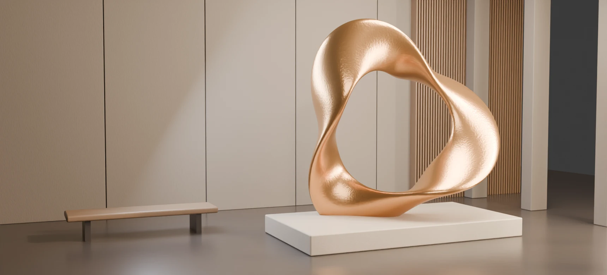

# Umbral

Galería de arte virtual abierta. [Entrar a la galería](https://luzbel33.github.io/umbral-gallery/).



## Visitar o exponer

El catálogo se puede abrir sin cuenta en un navegador. Cada sala tiene una vista web con reproductores accesibles y un recorrido 3D con teclado, mouse o controles táctiles. El portal iluminado y la brújula permiten cambiar de sala. «Caminar en compañía» conecta a los visitantes que eligen esa opción. Las salas guardadas se conservan en ese navegador.

«Crear sala» registra una llave de acceso WebAuthn con verificación del usuario. Elegí una llave sincronizada o una llave física que puedas conservar. El piloto admite una llave por cuenta. La pérdida de la única copia impide recuperar la cuenta. No se solicita correo. En el editor, elegí nombre, disciplina, descripción, color de paredes, piso y pista de ambiente. Las posiciones de exposición se asignan por orden de carga.

Cada artista dispone de ocho espacios de hasta 12 MiB cada uno. Las imágenes JPG, PNG y WebP se convierten en WebP de hasta 1920 px por lado. Se admiten videos MP4/WebM y audio MP3, Ogg, WAV o M4A compatibles con el navegador. Cada archivo es accesible por enlace directo desde la subida. «Mostrar mi sala» controla su inclusión en el catálogo. «Retirar» elimina el objeto de almacenamiento y libera el espacio. Para informar una infracción usá los [issues del proyecto](https://github.com/Luzbel33/umbral-gallery/issues) indicando la URL pública, sin datos personales. Quien opera la galería puede ocultar una sala desde la base.

## Ejecutar y publicar una copia

Requiere Node 22.12 o posterior, npm y un navegador moderno. WebGL 2 habilita el recorrido. El modo web funciona sin aceleración 3D.

```sh
npm ci
npm run dev
npm run build
```

Vite muestra la URL local. `BASE_PATH` permite cambiar el prefijo `/umbral-gallery/`. Los medios inaugurales ya están incluidos. El workflow de GitHub Actions compila y publica `dist/` en Pages al actualizar `main`. La vista previa de X, la descripción y el mapa de las cuatro salas iniciales se sirven como archivos estáticos.

Para alojar una copia independiente, creá un proyecto gratuito de Supabase, configurá `VITE_SUPABASE_URL` y `VITE_SUPABASE_PUBLISHABLE_KEY` y desplegá las migraciones. Los valores por defecto de `src/config.js` son datos públicos del piloto. Cambiá el origen, el sitio y el sitemap a los de tu copia antes de habilitar registros. Las llaves WebAuthn están vinculadas al dominio de alta. Reservá un dominio estable antes de una expansión y mantené bajo control todo el código servido en ese origen.

```sh
supabase link --project-ref TU_PROYECTO
supabase db push --linked
supabase secrets set GALLERY_ORIGIN=https://tu-dominio.example
supabase functions deploy gallery-passkeys --use-api
```

La función usa el secreto de servicio provisto por el runtime para verificar llaves y emitir sesiones únicamente tras una verificación WebAuthn satisfactoria. Los retos firmados vencen en tres minutos y se consumen una sola vez. No desactives la confirmación de correo para usar este método. Para probar el registro de otra instancia, usá el origen HTTPS configurado en ella. El entorno local, por defecto, permite explorar el catálogo del piloto.

Para pruebas de navegación, iniciá la app en el puerto 5178 y ejecutá `npx playwright test`. `GALLERY_TEST_URL` selecciona otro sitio y `CHROME_PATH` permite usar un Chrome instalado. Con el navegador de Playwright ejecutá previamente `npx playwright install chromium`.

## Operación y crecimiento

- **PostgreSQL** guarda salas y obras. Las políticas por fila restringen las escrituras al dueño. La reserva única por sala y posición limita las subidas concurrentes. Al retirar una obra se borra el archivo antes de liberar su reserva. Un corte de red puede dejar una reserva incompleta visible en el editor para retirarla.
- **Storage y CDN** sirven medios directamente. Los videos y las canciones se descargan al reproducirlos. El catálogo limita las consultas a páginas de 12 salas, y la vista 3D carga recursos de una sala por vez. Las portadas de artistas usan la primera imagen optimizada disponible. El motor 3D se importa al entrar a caminar.
- **Presencia** usa un canal Realtime por sala. El movimiento se envía hasta unas tres veces por segundo sólo al cambiar de posición u orientación. La posición es efímera. Se dibujan hasta doce visitantes de la misma sala, por orden de recepción. El modo individual sigue disponible durante una interrupción.
- **Costo del piloto.** GitHub Pages incluye un límite blando de 100 GB de transferencia mensual en sitios públicos. Supabase Free incluye 500 MB de base, 1 GB de archivos, 5 GB de egreso sin caché, 5 GB de egreso en caché y 200 conexiones Realtime simultáneas. El proyecto gratuito puede pausarse por inactividad. Verificá los límites vigentes antes de una campaña. [GitHub Pages](https://docs.github.com/en/pages/getting-started-with-github-pages/github-pages-limits) · [Supabase](https://supabase.com/pricing).
- **Si crece.** Medí almacenamiento y egreso por obra, conexiones y mensajes por sala, latencia y velocidad de cuadros en móviles. Antes de una convocatoria masiva, probá carga en una instancia separada. El primer cambio para video intensivo sería generar miniaturas dedicadas y transcodificaciones adaptativas, y mover los objetos a almacenamiento con CDN según su costo de entrega. Para concentraciones en una misma sala, agregá instancias con un cupo de visitantes por canal. La versión actual comparte el canal entre todos los visitantes sociales de esa sala.
- **Sustento.** Un patrocinio de muestras o cupos de archivo opcionales puede financiar almacenamiento y moderación manteniendo la exposición básica gratuita. Antes de monetizar, trasladá el frontend a un hosting compatible con ese uso, revisá los límites y publicá condiciones de servicio. Para una campaña abierta también hacen falta un canal privado de denuncias, moderación operativa, recuperación de cuenta y políticas de conservación. PostgreSQL es exportable y los objetos se pueden migrar en forma independiente. Como alternativa, Cloudflare D1/R2 requiere integrar identidad y presencia por separado.

## Arte, código y licencias

El código y las piezas originales de Estudio Umbral incluidas en este repositorio se distribuyen bajo [MIT](LICENSE). El arte que suba cada persona conserva sus derechos y no queda bajo la licencia del repositorio. Barlow Condensed y Space Grotesk usan SIL Open Font License 1.1. Sus licencias se incluyen en `public/licenses/`.

`art/render.py` reconstruye las cuatro exposiciones con Blender 5.2 y Cycles. Ejecutá `blender -b --factory-startup --python art/render.py`. `art/media.py` sintetiza la banda sonora original y genera el estudio de movimiento con Python, NumPy y FFmpeg.
